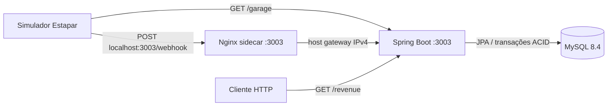

# Estapar Parking Backend

## Visão geral

Backend do desafio Estapar Backend Developer Test V1.5. A aplicação sincroniza setores e vagas do simulador, recebe os eventos `ENTRY`, `PARKED` e `EXIT`, controla capacidade e ocupação com consistência transacional, congela o preço dinâmico no estacionamento e consolida receita diária por setor.

A solução é um monólito modular: API, casos de uso, domínio e adaptadores de infraestrutura ficam separados por pacotes, mas participam das mesmas transações ACID. Essa arquitetura atende o escopo sem introduzir coordenação distribuída, mensageria ou serviços operacionais desnecessários.

## Tecnologias

- Java 21
- Spring Boot 4.1.3
- Spring MVC, Bean Validation e Actuator
- Spring Data JPA e Hibernate
- MySQL 8.4 e Flyway
- Maven Wrapper, JUnit 5, Mockito e Testcontainers
- Docker Desktop e Nginx sidecar

## Arquitetura



Fluxo interno de dependências:

```text
api -> application -> domain
          |
          +-> infrastructure (persistência, simulador, health e configuração)
```

- `api`: contratos HTTP, validação de entrada e mapeamento de erros;
- `application`: casos de uso, limites transacionais, inicialização e idempotência;
- `domain`: entidades, máquina de estados e políticas de preço;
- `infrastructure`: JPA, MySQL, simulador, health e configuração.

## Modelo de dados

O Flyway cria `sector`, `parking_spot`, `parking_session` e a linha de coordenação `garage_state`. Horários de negócio usam `Instant` e são persistidos em UTC como `DATETIME(6)`.

Uma sessão segue a máquina de estados:

```text
ENTERED -> PARKED -> EXITED
```

Sessões `ENTERED` ainda não possuem vaga ou setor. `PARKED` captura vaga, setor, preço-base e multiplicador. `EXITED` preserva essas associações como histórico e deixa de representar ocupação física.

O MySQL reforça invariantes com:

- `UNIQUE(sector.code)`;
- `UNIQUE(parking_spot.latitude, parking_spot.longitude)`;
- coluna virtual `active_license_plate`, única para sessões `ENTERED` ou `PARKED`;
- coluna virtual `active_parking_spot_id`, única para sessões `PARKED`;
- FKs, checks de status, preço não negativo e capacidade positiva;
- índice `(sector_id, exit_time)` para receita.

## Regras de negócio

### ENTRY

1. exige configuração da garagem pronta;
2. obtém `PESSIMISTIC_WRITE` em `garage_state`;
3. trata a mesma placa e `entry_time` como retry idempotente;
4. calcula a capacidade global como `SUM(sector.max_capacity)`;
5. conta `ENTERED` e `PARKED` como sessões ativas;
6. persiste uma sessão `ENTERED`, sem associar vaga prematuramente.

O lock serializa entradas concorrentes na última capacidade. A constraint de placa ativa é a proteção final no banco.

### PARKED

1. localiza a sessão ativa pela placa e a vaga pelas coordenadas exatas;
2. não volta a consumir capacidade global;
3. recusa vaga ocupada, mudança de vaga e lotação física do setor;
4. calcula o multiplicador com a ocupação setorial após o estacionamento;
5. congela preço-base e multiplicador na sessão;
6. grava `PARKED` e `OCCUPIED` na mesma transação.

O simulador não fornece o instante de estacionamento. Por isso, `parked_at` registra o instante UTC de processamento; cobrança usa exclusivamente `entry_time` e `exit_time`.

### Preço dinâmico

| Ocupação do setor após PARKED | Multiplicador |
| --- | ---: |
| menor que 25% | `0.90` |
| 25% até 50%, inclusive | `1.00` |
| acima de 50% até 75%, inclusive | `1.10` |
| acima de 75% | `1.25` |

Até 30 minutos, inclusive, a permanência é gratuita. Depois disso, toda a duração desde a entrada é cobrada em horas arredondadas para cima:

```text
amount = horas_cobráveis × preço-base-congelado × multiplicador-congelado
```

Os cálculos usam `Duration` e `BigDecimal`, com duas casas decimais e `RoundingMode.HALF_UP` no resultado final.

### EXIT

1. detecta primeiro retry pela placa e `exit_time` em precisão de microssegundos;
2. exige sessão `PARKED` e `exit_time >= entry_time`;
3. usa somente preço e multiplicador congelados;
4. calcula e persiste `amount` uma única vez;
5. grava `EXITED` e libera a vaga na mesma transação.

Uma falha ao persistir a sessão ou liberar a vaga reverte toda a operação. Uma reentrega antiga já conhecida não encerra uma sessão nova da mesma placa.

### REVENUE

A receita soma somente `parking_session.amount` de sessões `EXITED`, filtradas por setor e pela data local de `exit_time`. Sessões ativas são ignoradas e valores não são recalculados com o preço atual.

Os limites do dia são o intervalo semiaberto `[início, próximo início)` em `REVENUE_ZONE_ID`, convertido para UTC. A consulta usa o índice de setor e saída e só enxerga transações confirmadas.

## API REST

### `POST /webhook`

O endpoint aceita exclusivamente `Content-Type: application/json`. `event_type` seleciona um dos contratos.

ENTRY:

```json
{
  "license_plate": "ZUL0001",
  "entry_time": "2025-01-01T12:00:00Z",
  "event_type": "ENTRY"
}
```

PARKED:

```json
{
  "license_plate": "ZUL0001",
  "lat": -23.561684,
  "lng": -46.655981,
  "event_type": "PARKED"
}
```

EXIT:

```json
{
  "license_plate": "ZUL0001",
  "exit_time": "2025-01-01T13:30:00Z",
  "event_type": "EXIT"
}
```

Timestamps ISO-8601 com offset são convertidos para `Instant`. A imagem oficial envia horários sem offset usando relógio UTC; apenas na borda do webhook esse formato também é interpretado como UTC. Coordenadas usam `BigDecimal` com sete casas decimais.

### `GET /revenue`

`sector` é obrigatório. `date` é opcional e usa `yyyy-MM-dd`; sem data, vale o dia atual no fuso de negócio.

```powershell
Invoke-RestMethod "http://localhost:3003/revenue?date=2025-01-01&sector=A"
```

Resposta:

```json
{
  "amount": 18.00,
  "currency": "BRL",
  "timestamp": "2026-11-25T20:00:00Z"
}
```

Por compatibilidade com o desafio, `date` e `sector` também podem vir em body JSON no GET. Query parameters têm precedência, e valores divergentes retornam `400`.

### Códigos HTTP

- `200`: operação processada, inclusive retry idempotente;
- `400`: contrato, JSON, timestamp ou parâmetro inválido;
- `404`: vaga ou setor não encontrado;
- `409`: conflito de estado, capacidade, ocupação ou preço congelado;
- `415`: mídia diferente de `application/json` no webhook;
- `503`: configuração da garagem ainda não pronta;
- `500`: falha interna inesperada.

Erros retornam `code` e `message`, sem stack trace.

### Health checks

```powershell
Invoke-RestMethod http://localhost:3003/actuator/health
Invoke-RestMethod http://localhost:3003/actuator/health/readiness
```

Readiness só fica `UP` depois que a sincronização da garagem termina com commit.

## Execução local

### Pré-requisitos

- JDK 21 no `PATH`;
- Docker Desktop;
- Windows PowerShell 5.1 ou superior;
- portas exigidas pelo modo escolhido disponíveis.

Não é necessário instalar Maven globalmente.

### Banco persistente de desenvolvimento

```powershell
Copy-Item .env.example .env
docker compose up -d
docker compose ps
```

O Docker Compose lê `.env` automaticamente e publica o MySQL em `localhost:3307`. O arquivo contém somente credenciais locais de desenvolvimento e não deve ser reutilizado em produção.

O Spring Boot não carrega `.env` diretamente. Para alterar seus defaults, defina variáveis no processo PowerShell:

```powershell
$env:DB_URL = "jdbc:mysql://localhost:3307/estapar_parking?useSSL=false&allowPublicKeyRetrieval=true&serverTimezone=UTC"
$env:DB_USERNAME = "estapar"
$env:DB_PASSWORD = "estapar"
$env:GARAGE_SIMULATOR_URL = "http://localhost:3001"
$env:REVENUE_ZONE_ID = "America/Sao_Paulo"
```

Para executar a aplicação, use `.\mvnw.cmd spring-boot:run` depois de disponibilizar o simulador conforme a próxima seção. Para encerrar apenas o MySQL de desenvolvimento, sem apagar o volume:

```powershell
docker compose down
```

## Integração com o simulador

A imagem oficial envia webhooks para a URL fixa `http://localhost:3003/webhook` dentro do próprio container. Em rede bridge, esse endereço não é o Windows, e `EXTERNAL_API_URL` não muda o destino observado.

O Nginx sidecar compartilha o namespace de rede do simulador, escuta a porta interna fixa `3003` e encaminha para o gateway IPv4 do host. Ele não publica 3003, não armazena eventos e propaga os status reais do backend.

Para uma execução funcional e isolada, com MySQL descartável em `3308`:

```powershell
.\scripts\start-simulator.ps1

$env:DB_URL = "jdbc:mysql://localhost:3308/estapar_parking_e2e?useSSL=false&allowPublicKeyRetrieval=true&serverTimezone=UTC"
$env:DB_USERNAME = "estapar_e2e"
$env:DB_PASSWORD = "estapar_e2e"
$env:GARAGE_SIMULATOR_URL = "http://localhost:3001"
$env:REVENUE_ZONE_ID = "America/Sao_Paulo"
.\mvnw.cmd spring-boot:run
```

Ordem segura:

1. MySQL E2E em `127.0.0.1:3308`;
2. simulador em `127.0.0.1:3001`;
3. sidecar no namespace do simulador, sem porta publicada;
4. backend em `localhost:3003`;
5. `GET /garage`, sincronização transacional e readiness;
6. eventos automáticos do simulador.

Monitoramento:

```powershell
docker logs -f estapar-e2e-webhook-proxy
docker logs -f estapar-e2e-simulator
Invoke-RestMethod http://localhost:3003/actuator/health/readiness
```

Encerramento seguro:

```powershell
.\scripts\stop-simulator.ps1
```

O script de parada verifica nomes e label de propriedade antes de interromper apenas os três containers E2E. Como usam `--rm`, o banco isolado é efêmero. Consulte também [`docker/simulator/README.md`](docker/simulator/README.md).

No E2E de 25 de novembro de 2026, o simulador produziu automaticamente ENTRY, PARKED e EXIT. O snapshot final teve 20 sessões, sendo 7 `EXITED`, 13 `PARKED`, 13 vagas ocupadas e nenhuma violação de integridade. Os eventos válidos receberam `200`; um body inválido propagou `400` e a indisponibilidade do backend propagou `502`.

As permanências espontâneas foram menores que 30 minutos e resultaram em `0.00`. Cobranças positivas são verificadas deterministicamente nos testes do projeto.

## Execução dos testes

```powershell
.\mvnw.cmd clean verify
```

Os testes de persistência e concorrência criam MySQL 8.4 isolado com Testcontainers. Eles nunca usam o banco de desenvolvimento. A suíte cobre:

- ENTRY, PARKED e EXIT concorrentes;
- idempotência e reentregas tardias conhecidas;
- rollback forçado em todos os fluxos mutáveis;
- lotação global e setorial;
- constraints de placa e vaga ativas;
- thresholds do preço dinâmico;
- tolerância gratuita e cobranças positivas;
- fluxo `ENTRY -> PARKED -> EXIT -> REVENUE` com valor positivo;
- timezone, virada de dia, intervalo semiaberto e receita por setor;
- ausência de duplicação de receita após retry;
- sincronização idempotente e rejeição de redução de capacidade incompatível.

O simulador real não faz parte do build Maven. Seu E2E é explícito porque depende de Docker, portas locais e geração não determinística de eventos.

## Estratégia de concorrência

Todos os fluxos mutáveis e a sincronização obtêm `PESSIMISTIC_WRITE` na linha `garage_state` de ID `1`. O lock está no MySQL, portanto serializa também múltiplas instâncias da aplicação.

Isso impede overbooking global, dupla ocupação, multiplicadores calculados sobre a mesma fotografia e corrida entre EXIT e nova ENTRY. Constraints no banco permanecem como defesa adicional. A sincronização rejeita, com rollback, reduções de capacidade abaixo das sessões ativas ou estacionadas.

O custo é throughput global limitado: eventos de setores distintos também aguardam o mesmo lock. Para a escala e o objetivo do desafio, esse trade-off é preferível a locks distribuídos ou coordenação por mensagens.

## Idempotência

- ENTRY: mesma placa ativa e mesmo `entry_time` não cria nova sessão;
- PARKED: mesma sessão e mesma vaga não altera preço nem `parked_at`;
- EXIT: mesma placa e mesmo `exit_time` não recalcula `amount`;
- sincronização: configuração idêntica não cria nem atualiza registros;
- REVENUE: soma o valor persistido uma única vez, somente após commit do EXIT.

O contrato não fornece `event_id`. Portanto, uma reentrega antiga nunca registrada e semanticamente indistinguível de um evento novo não pode ser deduplicada com certeza. Eventos históricos já persistidos são reconhecidos antes de consultar uma sessão ativa nova.

## Decisões arquiteturais

- **Monólito modular:** mantém limites claros de responsabilidade e uma única transação ACID para sessão, vaga e cobrança.
- **Lock pessimista global:** oferece uma ordem total simples e verificável para capacidade e preço dinâmico, inclusive em múltiplas instâncias.
- **Sem Kafka ou microserviços:** o contrato é síncrono, o volume do desafio é pequeno e não há `event_id`; infraestrutura distribuída aumentaria estados de falha sem resolver a deduplicação contratual.
- **Preço congelado no PARKED:** alterações futuras no setor não reescrevem o histórico financeiro.
- **Receita derivada:** não existe tabela ou cache de receita; `amount` confirmado no EXIT é a única fonte financeira.
- **Instant e UTC:** persistência e eventos ficam independentes do relógio local; somente a fronteira diária da receita usa o fuso configurado.
- **Sidecar Nginx:** contorna a URL fixa da imagem oficial sem modificá-la e sem expor uma segunda porta 3003 no Windows.

## Trade-offs e limitações

- O lock global reduz paralelismo; uma evolução de escala exigiria particionamento cuidadoso sem perder a capacidade global.
- Sem `event_id`, há ambiguidade inevitável em reentregas antigas nunca registradas.
- Timestamps sem offset são aceitos como UTC somente por compatibilidade comprovada com a imagem oficial.
- `parked_at` é o instante de processamento, não um timestamp fornecido pelo simulador.
- Sessões legadas sem preço ou multiplicador congelado não são cobradas por estimativa; EXIT retorna conflito e preserva o estado.
- Setores e vagas omitidos numa nova sincronização não são removidos automaticamente.
- A porta 3003 do backend e do sidecar é fixa porque faz parte do comportamento da imagem do simulador.
- Endpoints não possuem autenticação, e as credenciais padrão são apenas de desenvolvimento; produção exigiria secret manager, TLS e controle de acesso.
- Imagens Docker usam tags versionadas, mas não digest imutável.
- O banco E2E é removido ao encerrar os containers.
